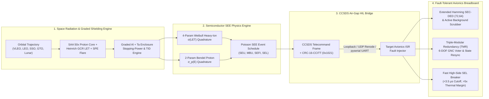

# RAD-FAULT-HIL: Open COTS-to-Orbit Space Radiation Transport, Single-Event Effect (SEE/SEU/SEL) Cross-Section & Automated Avionics Fault-Injection Qualification Testbed

[](reports/TRL4_DOSSIER.md)
[](reports/trl4_audit.json)
[](rad_fault_hil/hil_bridge.py)
[](LICENSE)

> **Institutional Attribution**: Jointly developed by **DIMASA (Digital Intelligence Maintenance for Aircraft Systems in Africa)** and the **Physics Hybrid Integrity Lab** as an open, reproducible COTS-to-Orbit radiation physics and hardware-in-the-loop (HIL) avionics fault-tolerance qualification platform.

---

## 1. Executive Summary & Engineering Motivation

Modern NewSpace, VLEO, LEO constellation, and cis-lunar missions increasingly rely on high-performance **Commercial-Off-The-Shelf (COTS)** semiconductors (ARM Cortex-M7 MCUs, RISC-V PolarFire SoCs, Zynq UltraScale+ MPSoCs, Micron DDR4 SDRAM, and Wolfspeed SiC MOSFETs). However, bare COTS silicon exposed to the **South Atlantic Anomaly (SAA)** trapped proton core ($>50\times$ flux spike), **Galactic Cosmic Ray (GCR)** heavy ions, and **Solar Particle Events (SPEs)** suffers from:
1. **Single-Event Upsets (SEU)** and **Multi-Bit Upsets (MBU)** corrupting volatile SRAM/DRAM and CPU floating-point registers,
2. **Single-Event Functional Interrupts (SEFI)** locking up GNC attitude control loops, and
3. **Destructive Single-Event Latchup (SEL)** triggering parasitic PNPN thyristor current surges ($I_{\text{SEL}} \to 4.8\text{ A}$) that melt bond wires and permanently destroy the flight computer within tens of microseconds.

**RAD-FAULT-HIL** bridges orbital radiation physics and embedded avionics fault-injection testing in a single, cryptographically reproducible **TRL 4** qualification framework:



---

## 2. Physics & Mathematical Formulation

### 2.1 Four-Parameter Weibull Heavy-Ion Cross-Section
For heavy ions with Linear Energy Transfer $\text{LET}$ ($\text{MeV}\cdot\text{cm}^2/\text{mg}$), the device upset/latchup cross-section is modeled via the 4-parameter Weibull function:

$$\sigma(\text{LET}) = \begin{cases} 0 & \text{if } \text{LET} \le \text{LET}_{\text{th}} \\ \sigma_{\text{sat}} \left[ 1 - \exp\!\left( -\left( \frac{\text{LET} - \text{LET}_{\text{th}}}{W} \right)^s \right) \right] & \text{if } \text{LET} > \text{LET}_{\text{th}} \end{cases}$$

### 2.2 Two-Parameter Bendel Proton Upset Cross-Section
For trapped Van Allen belt (SAA) and Solar Particle Event (SPE) protons of kinetic energy $E_p$ ($\text{MeV}$), nuclear spallation recoil upsets follow the 2-parameter Bendel formulation:

$$\sigma_p(E_p) = \left(\frac{B_p}{A_p}\right)^{14} \left[ 1 - \exp\!\left(-0.18\, Y^{0.5}\right) \right]^4 \times 10^{-12}\ \text{cm}^2/\text{bit}, \qquad Y = \left(\frac{18}{A_p}\right)^{0.5} (E_p - A_p)$$

### 2.3 Extended Hamming SEC-DED $(72,64)$ & Scrubbing MTBUE
Each 64-bit memory word is encoded into a 72-bit codeword with 7 Hamming syndrome bits at positions $\{1, 2, 4, 8, 16, 32, 64\}$ and 1 overall even-parity bit at position $0$. Periodic background scrubbing at interval $T_{\text{scrub}}$ increases the Mean-Time-Between-Unrecoverable-Errors ($\text{MTBUE}$) from birthday-paradox accumulation to:

$$\text{MTBUE}_{\text{scrubbed}} = \frac{N_{\text{words}}}{\lambda_{\text{SEU}}^2 \, T_{\text{scrub}}} \gg \text{MTBUE}_{\text{unscrubbed}} = \sqrt{\frac{\pi N_{\text{words}}}{2}}\,\frac{1}{\lambda_{\text{SEU}}}$$

---

## 3. Harmonized COTS Semiconductor Radiation Benchmark Library

| Component ID | Part Number & Process | $\text{LET}_{\text{th,SEU}}$ ($\text{MeV}\cdot\text{cm}^2/\text{mg}$) | $\sigma_{\text{sat,SEU}}$ ($\text{cm}^2$) | $\text{LET}_{\text{th,SEL}}$ ($\text{MeV}\cdot\text{cm}^2/\text{mg}$) | Bendel $A_p$ ($\text{MeV}$) | $\text{TID}_{\text{max}}$ ($\text{krad(Si)}$) |
| :--- | :--- | :---: | :---: | :---: | :---: | :---: |
| `STM32H7` | STM32H743ZIT6 (ARM Cortex-M7, 40nm CMOS) | `1.20` | `4.20e-2` | `12.5` | `18.0` | `22.0` |
| `POLARFIRE_SOC` | MPFS250T (RISC-V PolarFire SoC, 28nm SONOS) | `1.80` | `2.50e-2` | `68.0` | `22.0` | `65.0` |
| `ZYNQ_ULTRASCALE` | XCZU9EG (Zynq UltraScale+ MPSoC, 16nm FinFET) | `0.65` | `6.80e-2` | `16.0` | `14.0` | `40.0` |
| `MICRON_DDR4` | MT40A1G8 (Micron 8Gb DDR4 SDRAM, 20nm DRAM) | `0.90` | `9.50e-2` | `18.0` | `15.5` | `30.0` |
| `SIC_MOSFET` | C3M0065090D (Wolfspeed 900V 4H-SiC MOSFET) | `8.00` | `1.20e-4` | `10.5` | `35.0` | `150.0` |

---

## 4. Seven-Pillar TRL 4 Verification Scorecard

| Pillar ID | Verification Pillar | Acceptance Criterion | Status |
| :--- | :--- | :--- | :---: |
| `P1_WEIBULL_BENDEL_TRANSPORT` | Weibull/Bendel Rate Integration & Graded Al+Ta Shielding Physics | SAA proton spike $\ge 50\times$ & Al+Ta TID attenuation $> 2.5\times$ | **PASS** |
| `P2_SECDED_SCRUBBING_MTBUE` | Extended Hamming SEC-DED (72,64) & Active Scrubbing MTBUE | $100\%$ 1-bit correction, $100\%$ 2-bit detection, MTBUE gain $> 100\times$ | **PASS** |
| `P3_TMR_VOTER_SAA_RECOVERY` | TMR GNC Voter & Single-Frame State Resynchronization under SAA Storm | Protected pointing error $< 0.25^\circ$ (Unprotected diverges $> 35^\circ$) | **PASS** |
| `P4_SEL_THERMAL_PROTECTION` | Fast High-Side SEL Current-Limiting Breaker Thermal Survival Margin | Cutoff $< 5\ \mu\text{s}$ & $E_{\text{damage}} / E_{\text{thermal}} > 5.0\times$ margin | **PASS** |
| `P5_CCSDS_HIL_PROTOCOL_INTEGRITY` | CCSDS / JTAG-UART Binary HIL Bridge & CRC-16-CCITT Frame Integrity | $100\%$ valid TC/TM delivery + $100\%$ CRC-16 corruption rejection + UDP socket | **PASS** |
| `P6_CRYPTOGRAPHIC_REPRODUCIBILITY` | Deterministic Campaign Replay & Cryptographic SHA-256 Audit Identity | Bit-exact SHA-256 match across independent campaign runs | **PASS** |
| `P7_REALTIME_FRAME_BUDGET` | Real-Time Avionics TMR Voter + SEC-DED Scrubber Minor-Frame Budget | 99th-percentile step execution latency $< 10.0\text{ ms}$ ($100\text{ Hz}$ frame) | **PASS** |

---

## 5. Quickstart & Reproducible Execution

### Run the 16-Test Pytest Verification Suite
```powershell
$env:PYTHONPATH="c:\Users\User\Desktop\COMPLETED_PROJECTS\RAD-FAULT-HIL"
& "C:\Users\User\anaconda3\anacondaa\envs\aerospace\python.exe" -m pytest tests/test_rad_fault_hil.py -v
```

### Run the End-to-End TRL 4 Qualification Campaign
```powershell
$env:PYTHONPATH="c:\Users\User\Desktop\COMPLETED_PROJECTS\RAD-FAULT-HIL"
& "C:\Users\User\anaconda3\anacondaa\envs\aerospace\python.exe" examples/run_rad_trl4_campaign.py
```

Generated qualification artifacts in `reports/`:
- **`reports/rad_trl4_scorecard.html`**: Interactive dark-theme HTML5 Aerospace Control Room Dashboard with embedded SVG charts.
- **`reports/TRL4_DOSSIER.md`**: Publication-grade Markdown TRL 4 Qualification Dossier.
- **`reports/trl4_audit.json`**: Machine-readable JSON audit manifest with SHA-256 verification digest.

---

## 6. Renode Virtual CPU & Physical STM32H7 / RISC-V HIL Integration Guide

`rad_fault_hil/hil_bridge.py` implements a 30-byte binary **CCSDS Telecommand (APID `0x02A1`)** and 37-byte **CCSDS Telemetry (APID `0x03B2`)** wire protocol protected by **CRC-16-CCITT (`0x1021`)**:
- **`HilTransportMode.LOOPBACK`**: Deterministic in-memory binary wire verification.
- **`HilTransportMode.UDP_RENODE`**: Sends binary CCSDS fault-injection packets over UDP (`127.0.0.1`) to a Renode virtual CPU peripheral or socket bridge to flip live ARM Cortex-M7 / RISC-V registers.
- **`HilTransportMode.UART_PYSERIAL`**: Streams CCSDS fault-injection frames over a physical USB-UART / JTAG-UART interface (`serial.Serial` at `115200` baud) to an STM32H743 Nucleo or Microchip PolarFire SoC Icicle board under test.

---

## 7. License & Citation

Released under the **Apache-2.0 License**. See [`LICENSE`](LICENSE) and [`CITATION.cff`](CITATION.cff) for citation metadata attributing **DIMASA (Digital Intelligence Maintenance for Aircraft Systems in Africa)** and the **Physics Hybrid Integrity Lab**.
